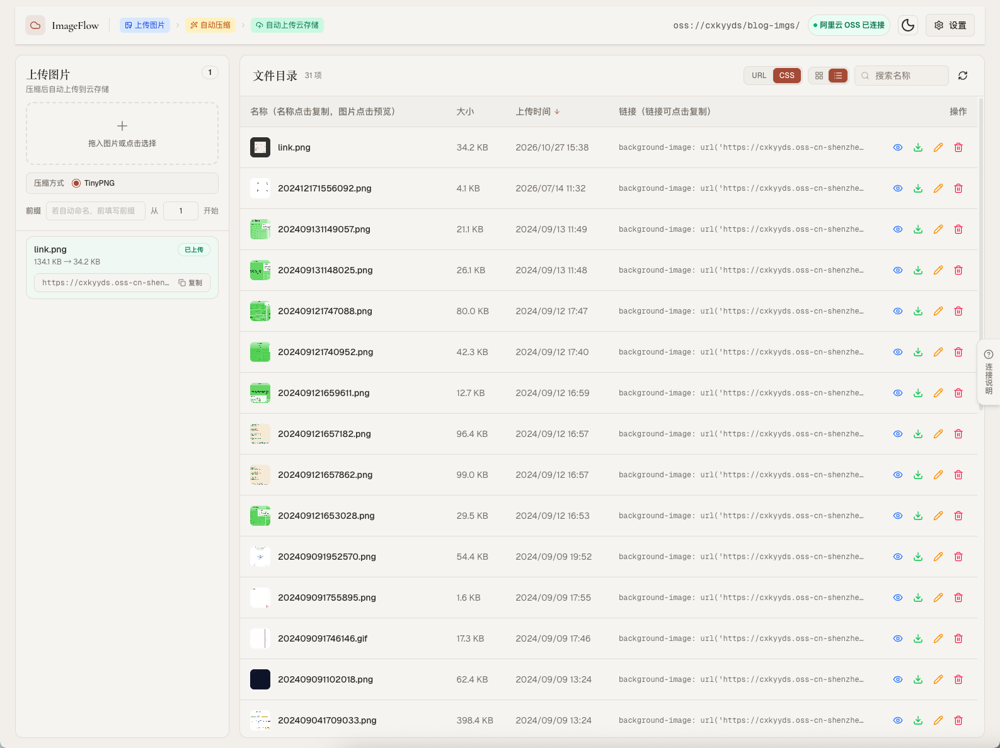
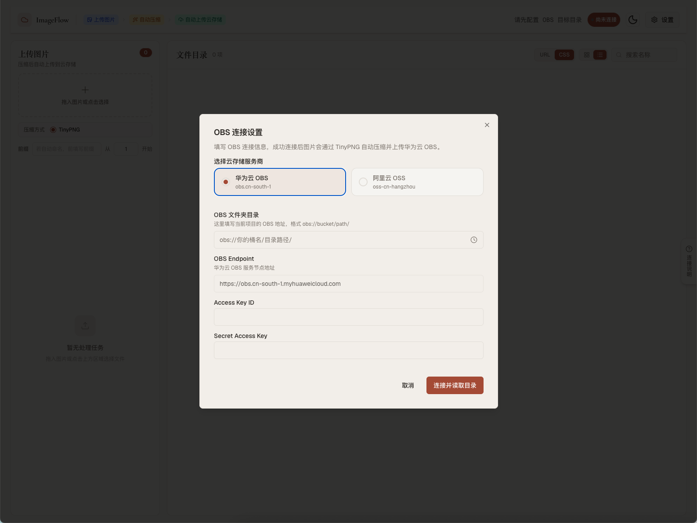

# ImageFlow — 图片压缩上传工作台

> 从蓝湖下载图片后，**拖进来就完事**：自动 TinyPNG 压缩 → 自动上传云存储（华为云 OBS / 阿里云 OSS）→ 一键复制对象存储图片 的链接。



---

## 一、背景

前端开发日常有一套高度重复的图片处理链路：

```
蓝湖下载切图 → 打开 TinyPNG 网站 → 逐张上传压缩 → 下载压缩后图片 → 打开 OSS 控制台 → 手动上传 → 复制外链
```

一张图走完全程要在 4 个网站之间来回切换，批量处理十几张切图时尤其耗时，属于典型的重复劳动。

**ImageFlow 把这条链路压缩成一步**：从蓝湖下载好的图片直接拖进软件，自动完成「压缩 → 上传 → 生成外链」，全程不用离开页面，压缩体积、上传状态、图片地址实时可见。

---

## 二、功能特性

- **拖拽即处理**：支持整图拖入窗口或批量选择文件，队列化处理，实时进度可见
- **TinyPNG 智能压缩**：无缝调用 TinyPNG 引擎，自动展示压缩前 / 后体积与压缩率
- **双云存储支持**：华为云 OBS、阿里云 OSS 一键切换，按文件夹（目录）上传
- **凭据安全保存**：AccessKey 经加盐加密后存于本地 localStorage，关闭重开免重复填写
- **文件夹历史**：自动记忆最近连接的 Bucket 目录，下次一键直连
- **批量命名规则**：支持文件名前缀 + 起始序号，方便按规范批量产出切图
- **外链一键复制**：上传成功后自动生成公网 URL，支持复制「图片地址」或「CSS `background-image`」格式
- **对象管理**：内置文件列表，支持刷新、重命名、删除、复制链接
- **双端形态**：既可作为纯 Web 页面在浏览器里用，也可打包成原生桌面应用（Tauri）

---

## 三、技术栈

| 分类 | 技术 |
| --- | --- |
| 前端框架 | **React 19** + TypeScript |
| 构建工具 | **Vite 8** |
| 样式方案 | **Tailwind CSS 4** + shadcn/ui（Radix UI） + lucide-react 图标 |
| 桌面端 | **Tauri 2.x**（Rust），可打包 macOS `.dmg` / Windows `.msi` `.exe` |
| 图片压缩 | TinyPNG Web API（经本地代理转发，规避浏览器跨域与 CORS 限制） |
| 云存储 SDK | 华为云 `esdk-obs-browserjs`、阿里云 `ali-oss` |
| 凭据存储 | localStorage + 自定义加盐 XOR 加密 |
| 交互反馈 | sonner（Toast）、copy-to-clipboard、vaul（Drawer） |
| 包管理 | **pnpm** |
| CI/CD | GitHub Actions（自动构建 macOS DMG） |

---

## 四、环境要求

- **Node.js** ≥ 20
- **pnpm** ≥ 9
- 若需运行 / 打包 **Tauri 桌面端**，额外需要：
  - Rust 工具链（stable，建议通过 [rustup](https://rustup.rs/) 安装）
  - macOS：Xcode Command Line Tools
  - Windows：Microsoft Visual Studio C++ Build Tools + WebView2

---

## 五、启动方式

项目提供 **两种使用形态**，按需选择。

### 方式一：Web 端（浏览器运行，轻量推荐）

纯前端页面，Vite 已内置 TinyPNG / OBS / OSS 转发代理，无需 Rust 环境。

```bash
# 1. 安装依赖
pnpm install

# 2. 启动开发服务器
pnpm dev
```

启动后浏览器访问：<http://localhost:5173>

```bash
# 生产构建（输出到 ./image-flow/ 目录，可直接部署到任意静态服务器 / Nginx）
pnpm build

# 本地预览生产构建
pnpm preview
```

> 注意：Web 端依赖 Vite dev server 的代理转发 TinyPNG 与云存储请求。生产部署时需在 Nginx / 网关上配置对应的反向代理（见 `vite.config.ts` 中 `/api/tinypng`、`/api/obs-proxy`、`/api/oss-proxy` 三条规则）。

### 方式二：Tauri 桌面端（原生窗口，推荐日常使用）

在 Web 端能力之上打包为原生桌面应用，窗口体验更贴近本机工具。

```bash
# 1. 安装依赖
pnpm install

# 2. 以开发模式启动桌面窗口（自动先起 Vite dev server）
pnpm tauri dev
```

### 打包发行

```bash
# 打包当前操作系统的安装包
pnpm tauri build

# 仅打包指定格式
pnpm tauri build --bundles dmg    # macOS
pnpm tauri build --bundles msi    # Windows
```

---

## 六、配置说明

首次打开后，点击右上角「设置」，在弹窗中选择云厂商（华为云 OBS / 阿里云 OSS），填写连接信息：



| 配置项 | 说明 |
| --- | --- |
| Provider | `obs`（华为云）或 `oss`（阿里云） |
| Endpoint | 存储 Region 接入域名，例：`https://obs.cn-south-1.myhuaweicloud.com` |
| Bucket 文件夹 URL | 目标 Bucket 下的目录公网地址，决定上传路径与外链拼接 |
| AccessKeyId / SecretAccessKey | 云账号 AK / SK，仅保存在本机浏览器中 |

环境变量（可选，复制 `.env.example` 为 `.env`）：

```bash
# 默认 OBS Endpoint，便于首次填入时自动补全
VITE_OBS_ENDPOINT=https://obs.cn-south-1.myhuaweicloud.com
```

---

## 七、目录结构速览

```
image-flow/
├── src/
│   ├── components/        # UI 组件（上传队列、文件表格、配置弹窗等）
│   ├── hooks/            # 拖拽、复制、预览等通用 Hook
│   ├── lib/
│   │   ├── tinify.ts     # TinyPNG 压缩流程
│   │   ├── obs.ts        # 华为云 OBS SDK 封装
│   │   ├── oss.ts        # 阿里云 OSS SDK 封装
│   │   ├── credentialVault.ts  # 凭据加密存储
│   │   └── proxy.ts      # 云存储代理转发
│   └── utils/
├── src-tauri/            # Tauri(Rust) 壳工程
├── vite.config.ts        # Vite + 三条本地代理规则
└── package.json
```

---

## 八、使用流程

1. 打开软件 → 配置一次云存储凭据（自动记忆）
2. 从蓝湖下载切图到本地
3. 直接把图片拖进 ImageFlow 窗口
4. 自动完成「压缩 → 上传」，完成后点击复制按钮拿到外链
